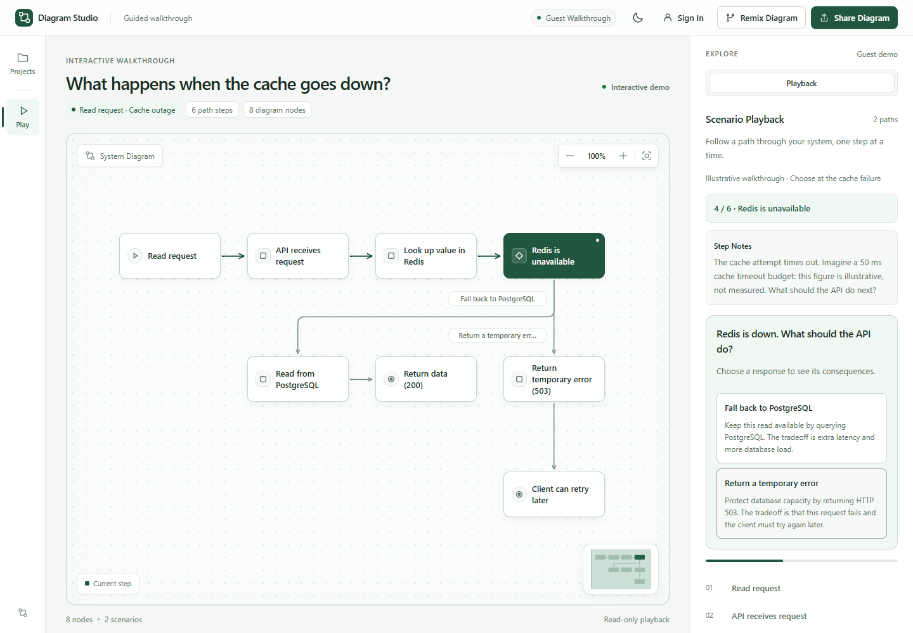

# Diagram Studio

A React + TypeScript editor backed by Spring Boot and PostgreSQL. Authors keep
private drafts, publish fixed playback snapshots, and let readers explore or
remix those snapshots without an account. The original standalone prototype is
preserved in `legacy/`.

**[Open the local walkthrough](http://localhost:8090/?walkthrough=cache-outage)**
— no account needed. Start it on Windows with `npm.cmd start` and wait for the
server to finish starting. **A public app demo has not been deployed yet.**

[85-second demo script, case study and verified CV bullets](docs/portfolio.md)
· [Deployment and post-deploy checks](docs/deployment.md)



## Try the standout walkthrough

**[What happens when the cache goes down?](http://localhost:8090/?walkthrough=cache-outage)**
follows a read request through an API, Redis and PostgreSQL. Start the walkthrough,
advance to the cache failure, then choose a database fallback or a temporary error.
Each path explains who gets data, what extra work happens, and the tradeoff.
Restart to try the other choice. No account is required and your local draft is
preserved. This is an illustrative explanation, not a live Redis outage or a
benchmark; the example 50 ms budget is explicitly illustrative.

Start the app using the instructions below, then open the link. The same entry is
featured in the app's Playback inspector. For Vite development, use
`http://localhost:5173/?walkthrough=cache-outage`. The walkthrough's relative path
is `/?walkthrough=cache-outage` on any future deployment; no public demo is deployed yet.

See [CONTRIBUTING.md](CONTRIBUTING.md) for the branch, pull request and verification
workflow, and [CHANGELOG.md](CHANGELOG.md) for the repository baseline and new changes.

For the verified publication, revision and concurrent-save design, see
[the engineering story](docs/engineering-story.md), including an interview-ready
decision and steps to reproduce the two-tab recovery flow.

Account creation requires an email code. Configure [Gmail SMTP or the local test
mailbox](docs/email-setup.md) before registering an account.

After signing in, open your name in the header for **Account Settings**. You can
edit your display name, change your password, review recent security activity or
sign out every device. Password changes sign out all sessions; local diagrams remain.

Use **Forgot Password?** to recover a verified account through email. To run with
real Gmail delivery, use `powershell -NoProfile -ExecutionPolicy Bypass -File scripts/start-gmail.ps1`
after creating a Google App Password; the launcher prompts without saving it.

For request tracing, Problem Details, operational metrics, rate limiting,
transactional audit, pagination/search, production profiles and Java integration
tests, see [backend/README.md](backend/README.md). The account flow is now explicit:
create an account, sign in, then acknowledge the signed-in confirmation.

## Run on this Windows computer

Node, Java 25, Maven, and PostgreSQL are required on this computer.
From this folder:

```powershell
npm.cmd install
npm.cmd start
```

Open **http://localhost:8090** after the server reports that it has started.
Keep the terminal running. `npm start` starts an isolated PostgreSQL cluster,
builds the frontend, packages it inside Spring Boot, and starts the application.
The first build downloads dependencies and runs backend validation tests. Press Ctrl+C to stop the application;
`npm run db:stop` stops its database. Do not run a second API on port 8090 while
starting or packaging the application.

The local database lives in `.runtime/postgres`, listens only on 127.0.0.1:55432,
and uses the `diagram_studio` database. It does not connect to any existing CRUD
application or its database. Local development credentials are in
`backend/src/main/resources/application.properties`; set `DB_USER`, `DB_PASSWORD`,
and `DB_URL` to override them. Set `DB_PASSWORD` before the **first** local database
initialization if you want a different password. Do not delete `.runtime/postgres`
if you want to keep your accounts and online-saved projects.

The Windows launcher serializes database starts and reuses an available project
cluster. It checks the data directory before creating databases and rechecks
connectivity after the build. Startup errors are appended to
`.runtime/postgres-server.log`. Do not delete the data directory or PID files to
fix a startup error. Windows CI checks cold start, simultaneous launchers and data
preservation across a clean restart.

## Development

Use three terminals from this folder:

```powershell
npm run db:start
```

```powershell
npm run backend
```

```powershell
npm run dev
```

The frontend is at **http://localhost:5173**; Vite proxies `/api` to Spring Boot
at port 8090. `scripts/backend.ps1` chooses a JDK for this process and uses Maven
or its wrapper without changing system Java settings. On other operating systems,
use PostgreSQL or `docker compose up db`, then `cd backend && ./mvnw spring-boot:run`.

## Create, publish, and remix

1. Open an example or build a diagram. Local edits save automatically in this
   browser, with undo/redo, branching scenarios, node notes, and review flags.
2. Create an account using **Sign In → Create an Account**, verify the email code,
   then sign in. No seeded accounts or
   administrator password are shipped.
3. Choose **Save Online**. Projects in PostgreSQL appear under **My Projects** and
   can be opened from another browser after signing in. Online saves are explicit;
   **Saved Locally** means the newest edits still need **Save Online**.
4. Choose **Publish & Share** to save the current draft and create a public
   `/p/{id}` snapshot. Editing the draft later does not change that snapshot.
5. Readers can play without an account. **Remix This Diagram** opens an independent
   workspace; signed-in readers also get an independent project in their account.

The existing `diagram-studio-v1` and separate remix browser-storage keys migrate
automatically when the app is served from the **same origin**. Browser storage is
scoped to an origin: an old `file://` project or a different localhost port is not
accessible to the new app. Export JSON from `legacy/index.html` in the old browser
context, then import it into the React app. Existing version-1 JSON exports and
hash-based playback links remain supported at the new app URL.

Import and example replacement preserve undo history and detach the workspace
from an online project so saving cannot accidentally overwrite a different draft.
Opening another saved project or creating a blank project starts fresh history.
Signing out clears the current local workspace after confirmation. A project
delete revokes all its published links; a scenario delete is undoable.

## Data and API

The workspace has separate **Playback**, **Editor**, and **Project** inspector
tabs. Select a node to open the editor. Example projects, JSON files and online
version history are available under Project. The navigation rail offers the
same views on desktop; the tabbed inspector remains available on mobile.

### Persistent version history

Every successful online create/save records a full JSONB revision in the same
transaction as the draft write. **Project → Version History** lists the latest
100 saved versions and previews each version's title, nodes and scenarios.
Choose **Preview** to compare that saved revision with the current draft, including
unsaved edits. Side-by-side graphs highlight added, removed and changed nodes and
connections; expandable details show labels, positions, notes, ordered steps,
scenario descriptions and review notes before and after. The comparison is read-only.
Scenarios currently match by name (duplicate names by occurrence), so renaming a
scenario appears as removal and addition rather than an inferred rename.
Restoring requires confirmation and the expected current version. It creates
a new version rather than rewriting old revisions or public snapshots. A stale
restore returns 409, preserving the current document. V2 seeds a baseline for
existing projects; versions overwritten before that migration cannot be recovered.

This is distinct from the browser's temporary undo/redo history. Project deletion
removes its revisions and revokes its published links through foreign-key cascades.

### Storage and access

Flyway runs the versioned SQL migration automatically. Tables store accounts,
owned JSONB drafts with revision numbers, immutable publications, and server-side
sessions. Passwords are hashed with bcrypt. Session cookies are HttpOnly and
SameSite=Lax; writes require CSRF tokens. The frontend never stores passwords or
authentication tokens in browser storage.

Concurrent saves return 409 instead of overwriting another session's edits.
The UI keeps the local document and offers **Save as Separate Copy**. Private
project endpoints require ownership and use 404 for other users' IDs.

See `api/openapi.json` and `api/contract.md`. Rebuild the machine-readable contract
with `node scripts/generate-openapi.mjs` after changing its source. JSON requests
and file imports are limited to 1 MB; documents support 500 nodes, 100 scenarios,
and 500 steps per scenario.

## Verification

For reproducible 100-node and 500-node playback workloads, measurements, profiling
and their limitations, see [the playback benchmark](benchmarks/README.md).

```powershell
npm test
npm run build
powershell -NoProfile -ExecutionPolicy Bypass -File scripts/backend.ps1 test
npm run test:api
npm run test:e2e
```

The HTTP tests need the backend and database running. They register disposable
test accounts and remove their project fixtures through the API. Browser tests
use installed Chrome and a real API/database; a development server is started
automatically if port 5173 is free. Screenshots are written to `.runtime/`.
Use `API_URL` to choose a different API test target and `APP_URL` for a browser
test target. No external HTTP providers are required or mocked.

## Containers and deployment

```powershell
docker compose up --build
```

This packages React inside the Spring Boot JAR and starts PostgreSQL with a
persistent Docker volume. Open http://localhost:8090. Stop the native local
database first if it is using port 55432. Docker is an alternative to the native
Windows setup; the container build has not been executed on this computer.

For an Internet deployment, provide a PostgreSQL database and run the built
application image behind HTTPS. Set `DB_URL`, `DB_USER`, `DB_PASSWORD`, and
`COOKIE_SECURE=true` using the hosting platform's environment settings. Serve the
UI and API from one origin. Use a strong database password, persistent database
storage, backups, and an ingress limit for authentication requests. Publish links
only after the public host is live; localhost links work only on your computer.

This is a functioning first application release. Email verification, password
recovery, collaborative editing, and an administrative console are not included.
No hosting account has been created or public deployment performed.

Framework references: [React + Vite](https://react.dev/learn/build-a-react-app-from-scratch),
[Spring Boot requirements](https://docs.spring.io/spring-boot/system-requirements.html),
[JDBC-backed sessions](https://docs.spring.io/spring-session/reference/guides/boot-jdbc.html).
